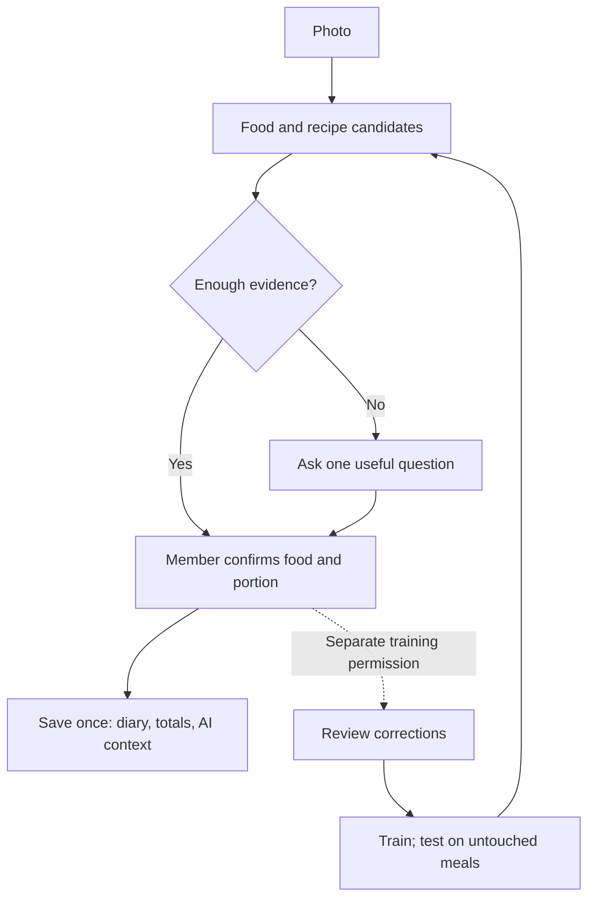

# Shift photo recognition: route towards the requested 99.99% precision and recall

Requested by Matt on 1 November 2026, Europe/London. Work stays within the
existing own-model branch, existing compute and public licensed data authority.
No new service, purchase, contact, member-photo training or production activation
is authorised by this research plan. Existing approval boundaries remain.

## What the target means

Precision is correct visible-component suggestions / all component suggestions.
Recall is visible components found / all annotated visible components, including
components in rejected photos and disabled classes. Both requested targets are
0.9999. A rejected or uncertain photo cannot disappear from recall. Confirmed or
corrected diary entries are a separate workflow metric; they cannot inflate
photo-only recognition. Recipe identity, portion size and nutrition need their
own truth and metrics. A known recipe estimate is not laboratory-verified energy.

A single image cannot establish invisible additions, substitutions or physical
quantity. Similar-looking meals can have different ingredients. Use recipe,
packet, portion evidence and member confirmation to supply those missing facts.
No near-perfect photo-only or member-assisted claim has been established.

The previous headline comparison used eleven shared coarse categories. Keep that
as a diagnostic. The primary development scorecard includes all 39 declared
visible categories and the existing food-presence gate. Unknown/unfamiliar foods
need a separate benchmark and must not be treated as correct non-food rejects.

## Target workflow — design, not a claim that all UI steps are live

Photo recognition must provide a draft and preserve unknown nutrients. Use the
existing single diary writer after explicit member save. Exact recipe numbers
need the governed recipe hash, confirmed serving and substitution check. The
recipe-draft-to-diary bridge has fixture acceptance but is not live recipe-UI
hookup. Camera/training permission remains separate from diary confirmation.

## Finite work packages and current state

| Priority | Work | Observable finish | State / owner |
| --- | --- | --- | --- |
| 1 | Lock measurement and score denominators | Full vocabulary, rejected-photo misses, shared-category diagnostic and assisted-record metrics separated | Implemented and tested / Codex |
| 2 | Test imbalance and head capacity | Four fixed variants, validation-only choice, saved-head round trip, unchanged test scope | Executed / Codex |
| 3 | Preserve useful prior learning | Validation-only three-head routing, one image encoder pass, complete JPEG reload and adapter check | Executed locally / Codex |
| 4 | Establish the collection method | Twelve real recipe families, five independent cooks each, three views; rights/review/version checks | 180-photo method-pilot brief prepared; zero photos collected |
| 5 | Broaden to UK meals | Forty recipe formats, 25 independent cooks each, three views; source-group-safe split | 3,000-photo / 1,000-cook-session shot list prepared; collection unstarted |
| 6 | Improve visual features | Train learned localisation and fine-tune selected visual layers with balanced reviewed data; compare one change at a time | Depends on qualified data; no GPU purchase assumed |
| 7 | Prove generalisation | Freeze at least 200 blind UK cook sessions and at least 100 independent real non-food examples; sufficient support for every advertised class | No qualified UK acceptance corpus yet |
| 8 | Verify the 99.99% claim | Predeclared population/scope, independent representative trials, per-class and subgroup checks, paired precision/recall confidence analysis | Target unproved; small development results cannot pass |

The first 180 images qualify the collection method only; they are not production
acceptance. The scaled planning quota is 15 train / five validation / five blind
sessions per format, but household/source groups take precedence and quotas must
be verified against actual records. Related photos are not independent meals.
Choose the primary held-out view before model results, and report multi-view
performance with capture clustering. Each advertised class still needs adequate
blind positive and predicted support; family counts do not establish that.

Collection should cover light, phone, background, containers, sauces, mixed
plates, small portions, leftovers and recorded substitutions. Use explicit
visible-component labels; store known hidden recipe ingredients separately.
Two independent label reviews and adjudication precede the blind-label freeze.
Training, calibration and acceptance sets stay separate across versions.

The existing intake/qualification modules supply rights receipts, image hashes,
recipe-version checks, source/capture groups and explicit review. Do not replace
these with AI-generated examples, old illustrative recipe images or silent reuse
of member photos. Permission evidence must actually exist before admission.
The shot list is a collection brief, not consent or an instruction sent to anyone.

## Executed experiment and its trade-off

Candidate 7 tested linear/nonlinear heads with square-root/full class balancing,
using only existing frozen full-image features and the fixed 574/274/208 split.
The nonlinear square-root variant won on validation. On all 39 development
categories its precision/recall is 79.83%/46.63%, compared with candidate 6's
81.75%/36.20%. The saved head reproduced all 208 cached-feature predictions.

Candidate 8 routes between the existing heads and the new selected head, using
validation only and preserving original thresholds. Shared-category precision /
recall is 83.08% / 66.77%, versus candidate 6's 84.85% / 50.76%. All-39 ungated
results are 78.47% / 48.48%. Thus coverage improved while precision regressed.
This is a research alternative, not a promotion over candidate 6 and not evidence
of improvement in both measures. Do not cherry-pick recall or replace the common
scorecard. The existing production flags stay off; no model is deployed here.

The complete JPEG/gate/adapter receipts are alongside this plan. None is blind
UK, real non-food or installed-device acceptance. Architecture/routing choices
used validation, but the development test was already inspected during earlier
experiments. A new UK holdout is essential before claiming generalisation.

## How much proof 99.99% needs

For zero observed errors and independent representative Bernoulli trials, the
exact one-sided lower success bound is alpha^(1/n). Solving for a 0.9999 lower
bound at 95% confidence requires 29,956 zero-error trials for one metric. A
conservative Bonferroni allocation for both metrics at simultaneous 95%
confidence requires 36,887 per appropriate denominator. These are calculated
illustrations, not a sufficient image quota or a guarantee: food components and
photos within meals are correlated, class mix can shift, and precision/recall
have different denominators. Current four-week public data cannot support this
claim. Formal acceptance must respect sampling units and subgroup uncertainty.

Statistical source: NIST, exact binomial confidence intervals:
https://www.itl.nist.gov/div898/handbook/prc/section2/prc241.htm
Public data source and scope:
https://github.com/google-research-datasets/Nutrition5k

## Prior batch dependency assessment — superseded for independent public-data work

The code and existing-data experiments are completed for this bounded batch.
The next high-value dependency is real, independently reviewed UK meal/negative
data. The versioned 40-family collection brief is ready at
`evidence/uk-field-pilot-shotlist-20261101.json`; no photos, requests or costs have
been created. Existing consent, rights and cost holds still apply. Do not imply
that work continues unattended after the running experiment has finished.

## Spatial recognition and independent public-data continuation — 1 November 2026

Continued after Matt flagged that work had stopped. The earlier wording that UK
photos were the sole next dependency was too broad: UK field data is required
for UK acceptance, while licensed public-data development can continue now.

Implemented and trained a coarse 14x14 food/background localiser using the
existing 574 training segmentation masks. Frozen SigLIP patch vectors plus global
context feed our own regional heads. Validation and test prediction use only RGB;
no ground-truth crops, held-out masks or annotation CSV are needed at inference.
A nonlinear regional head, then four fixed seeded heads sharing one encoder,
were selected using validation only. All 39 categories remain in the score.

Full-39, gate-applied, same 208 development photos: candidate 6 precision/recall
81.96% / 35.19%; regional ensemble 15 is 83.00% / 56.73%. All 208 real-JPEG scores
reproduce within 1.97e-6. Warm inference averages 273 ms in this run. The actual
shared adapter reuses a ready worker, refuses private fields and closes it.
These are previously inspected public-development results, not UK acceptance.

Acquired 73 separately licensed Open Images validation photos and 90 separate
training photos with original-page CC BY 2.0 evidence, source attribution and
publisher CC BY 4.0 object annotations. Validation photos/authors are excluded
from training. Unlabelled foods remain unknown. Training uses weak positive-box
loss alongside the original dense masks, never invented complete meal labels.
The validation source contains only partial truth: on 60 mapped known-positive
cases, candidate 6 hits 35%, ensemble 15 hits 40%, transfer head 16 hits 56.67%.
Precision on that partial-label probe is unknown. Generalisation remains weak.
The new transfer ensemble did not outperform ensemble 15 on the main scorecard;
all outcomes, including regressions, are retained.

The acquisition corrected two actual implementation limits: CC BY 2.0 /deed.en
is the same licence as its root URL, while restricted variants remain rejected;
and the unsorted training-credit CSV needs a bounded streaming match rather than
a short prefix. Original source-page evidence and failed checks remain recorded.
No account, contact, spend, private member photo or production activation occurred.

A real non-food diagnostic has been launched on a fixed publisher-human Food-negative
cohort, excluding contradictory positive food descendants and training authors.
Its results are recorded separately; the four old blank/noise controls are not a
real non-food benchmark. No threshold is tuned on that diagnostic. Completion
receipt: `shift-ai-food-model/evidence/nonfood-completion-20261101.json`.

Evidence: `shift-ai-food-model/evidence/spatial-progress-20261101.json`.
The requested 99.99%/99.99% remains unverified. Existing release floors, privacy
holds and source/capture split checks remain unchanged. No rollout is authorised.

The first proposed non-food cohort was invalidated after visual inspection: the
publisher Food-class-negative label does not establish absence of drinks or all
ingredients. No such labels entered fitting. All raw results and 100 review
states are retained in evidence/nonfood-completion-20261101.json. Only 16 cases
were provisionally clear non-food; this is not independent acceptance. The new
object-positive candidate cohort requires visual adjudication before any valid
negative rate can be reported. This is enforced in the benchmark code.
